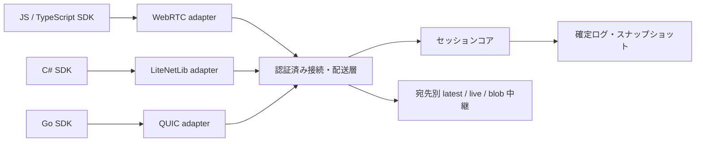

# kokosync v0: 通信方式を隠し、同期の保証と通信状況を共通化する

状態: 設計草案 / 2026-10-21

実装後の範囲と確認結果は[実装状況](implementation-status.md)を参照。本文は当初の設計草案として残し、任意データの配送を基本にして`state`を任意利用とする変更は、実装状況と[実行版の通信仕様](../protocol/prototype.md)へ反映している。

## 1. アプリごとに同期処理を作り直さずに済む基盤を作る

kokosyncは、WebRTC・LiteNetLib・QUICで接続するクライアントを同じセッションへ収容し、任意の構造化データとバイナリを交換するライブラリ・サーバーである。JS / TypeScript、C#、Goで、同じ意味のAPIを提供する。

出発点はTonariumのUXプロトタイプである。そこで得た、共有オブジェクト、位置、イベント、途中参加、動画配信の要求を汎用化する。アプリ固有のアイテム型や描画状態は持ち込まない。開発者はデータと権限を定め、接続、同期の追いつき、再送、流量制御はSDKへ任せる。

この文書の「採用案」は今回の提案であり、ユーザーが承認済みの最終仕様を意味しない。技術上の事実には参照元を付け、未計測の数値は[検証計画](validation.md)に分ける。

| 与えられた要求 | v0での解釈 |
| --- | --- |
| 異なる通信方式で同時参加 | WebRTC・LiteNetLib・QUICの接続を終端し、共通のセッションへ中継する |
| MessagePackを使う | 操作・状態・制御情報の標準形式。大きなバイナリは分割して渡す |
| JS / C# / Goから透過的に使う | 同じ同期意味論とエラーを提供し、言語ごとの非同期APIに合わせる |
| 動画を流せる容量と低遅延 | ライブフレームとファイルを分離し、帯域不足時の破棄・待機を明示する |
| 通信状況を取得できる | セッション・経路・論理チャネル別の統計と状態変化をSDKで公開する |

回線の容量を超えるデータを無制限に送り、すべてを無損失かつ低遅延で届けることは保証しない。帯域が足りないときもメモリが増え続けず、操作をできるだけ維持し、何が遅れたかを観測できることを目指す。

## 2. データの寿命に合わせて五つの入口を設ける

| API | 例 | 保持・配送 |
| --- | --- | --- |
| `state` | 配置、盤面、設定、アプリ独自オブジェクト | サーバーが確定。途中参加・再接続で復元 |
| `latest` | 位置、向き、カーソル | 送信者とキーごとに最新値を優先。欠落を許容 |
| `events` | リアクション、操作通知 | 現在の購読者へ通知。途中参加者へ過去を再生しない |
| `blobs` | 画像、モデル、保存動画、初期状態の大きな添付 | 完全性を確認し、流量制御・キャンセル・再開を行う |
| `live` | エンコード済み動画・音声、センサーフレーム | 期限内に届くフレームを優先。古いものや復元不能なものは破棄 |

同じ動画でも、ファイル共有は`blobs`、その場の配信は`live`である。ライブフレームを共有状態の更新履歴に積まない。チャットを後から読みたい場合は、アプリが`state`や別の履歴サービスへ保存する。

公開APIの`blobs`と初期snapshotの転送には、内部の`bulk`チャネルを使う。snapshotは、ある時点の共有状態をまとめたデータである。

「任意のデータ」は、MessagePackで定めた値と、バイト列を意味する。クラスの実体、関数、循環参照、GPUリソースまで自動複製する機能ではない。競合時の業務判断も、アプリが条件付き更新などで指定する。

## 3. 同じセッションへの所属を、接続方式から独立させる

WebRTCのDataChannel、LiteNetLibのUDPパケット、QUICのstream/datagramは、互いのwire形式を直接理解しない。同じMessagePackを採用しても、この差は消えない。サーバーが通信を終端し、kokosyncのメッセージとして宛先へ再配送する。

セッションコアは参加・退出、権限、共有状態の確定、購読、初期同期を担当する。連続更新やライブフレームのバイト列は、認可済みの配送層が扱い、状態更新の直列処理へ載せない。大量の動画が部屋の状態更新を待たせないためである。

識別子は以下を分離する。

| 識別子 | 意味 |
| --- | --- |
| `principalId` | 認証したユーザーまたはサービス。表示名は別属性 |
| `peerId` | 参加しているアプリインスタンス。同一ユーザーの複数端末を区別 |
| `connectionId` | 一つの接続。切断・張り直しで変わる |
| `sessionId` / `epoch` | 部屋の識別子と、サーバーが管理する実体の世代 |
| `membershipId` | 一回の参加資格。再入室と同じ接続の復旧を区別 |

サーバーは接続へ認証情報を結び付ける。送信データに書かれた送信者IDだけでは本人と認めない。

## 4. 共有状態は一つの決定者が順序を確定する

v0では、各セッションを一つのサーバー上の実行単位が担当する。受理した変更へ単調増加する`revision`を付け、状態・操作ID・応答を同じ永続化トランザクションで記録してから成功を返す。`set`、`delete`と、版が一致するときだけ更新するCAS（compare-and-set）を用意する。

例えば二人が同じ駒を同時に動かす場合、現在の版を指定した一方だけが成功する。自由な上書きを許すオブジェクトでは、サーバーで後に確定した値を採用する。どちらを使うかはアプリが選ぶ。

標準のセッションは永続化ありとする提案。開発用に`durability: "memory"`を選べるが、サーバー再起動で失われることを接続情報に明示する。保存先の具体的なDB・ログ形式は未決である。

位置のような`latest`は、この順序へ混ぜない。`membershipId + publisherEpoch + key + sequence`で新旧を判定する。所有権が必要なら、確定状態に記録した貸与世代を添える。古い所有者や退出済みpeerからの更新は拒否する。

## 5. 中継を基準経路にし、P2Pは品質が合う組だけで使う

異種クライアントの混在を、最初から中継で成立させる。P2Pは`latest`と`live`の追加経路とし、サーバーが入室資格と直接接続先を認可する。同じWebRTCを話せる組などで直接経路を評価する。LiteNetLib同士も候補にできるが、NAT越えと安全な接続が成立することが条件となる。

確定状態とその操作は、P2Pが使えるときもサーバーを通す。接続構成が変わっても結果が変わらず、途中参加の取得先が明確になる。P2P経路が切れても、制御接続が生きていれば中継へ戻す。

経路変更では短時間だけ両方へ同じ番号を送ってよい。受信側が重複と古い更新を捨てる。古い経路の到着で状態が巻き戻らないことを、接続方式に依存しない規則にする。

完全メッシュは既定にしない。`n`人で`n(n-1)/2`組になり、各端末の上りも増える。必要な購読関係だけを結び、上り帯域、CPU、RTT、中継コストを見て選ぶ。制御サーバーが停止している間の新規参加・状態確定はv0では提供しない。

## 6. 言語ごとのSDKと、通信方式ごとのadapterを分ける

「三言語対応」は、全言語に全通信ライブラリを移植する意味ではない。まず以下の組み合わせで同じセッションへ参加できることを完成条件にする。

| 実行環境 | 必須adapter | 追加候補 |
| --- | --- | --- |
| JS / TypeScript・ブラウザ | WebRTC DataChannel | WebTransport、WebSocket縮退接続 |
| C#・.NET / Unity | LiteNetLib | QUIC、WebRTC。OS・IL2CPP・ネイティブ依存を別途検証 |
| Go・ネイティブ | QUIC stream + DATAGRAM | Pion WebRTC |
| JS・Node.js | 最初はWebSocket縮退接続を明示 | ネイティブ依存または別adapterで能力を拡張 |

ブラウザから生のLiteNetLibや生のQUICソケットを使えるという前提にはしない。WebTransportを追加する場合も、対応するHTTP/3終端が必要になる。[WebTransport仕様](https://www.w3.org/TR/webtransport/)はブラウザとサーバー間のstream/datagram APIを定義している。

adapterの違いは[SDKの共通契約](sdk.md)で吸収する。ただし、非対応の機能や統計を隠して成功扱いにしない。能力情報を返し、必須機能が足りなければ参加またはチャネル作成時に失敗させる。

### 実装言語・依存は次を採用候補とする

サーバーのセッションコアとWebRTC / QUIC終端はGo、LiteNetLib終端は.NETとする案。Goには[Pion](https://github.com/pion/webrtc)と[quic-go](https://github.com/quic-go/quic-go)がある。LiteNetLibのwire形式をGoで独自再実装せず、[公式ライブラリ](https://github.com/RevenantX/LiteNetLib)を使う。

.NET終端は同一ホストの別プロセス（sidecar）とし、認証済みの内部接続でコアへ渡す。プロセス間通信（IPC）はUnix domain socketまたはWindows named pipe等を候補にし、フレーム長・宛先・チャネル・残り期限を伝える。IPCにも容量制限と、受信側が追加で受け入れられるバイト数（credit）を設ける。sidecarが成功を返せるのは、コアの確定応答を受けた後だけとする。

sidecarのコピー回数と遅延が目標を満たすかは実測する。満たせなければ配置・IPC方式を再検討する。この案を「GoだけでLiteNetLibまで実装済み」と扱わない。

## 7. 大容量でも待ち行列を制御し、低遅延通信を残す

論理チャネルを分けるだけでは不十分である。ネットワーク、暗号処理、OS、ランタイム、gateway、受信者側のどこでも待ち行列が作られる。送る前の優先制御、同時処理数、容量の上限、アプリへ返す待機通知まで設計する。

`control`、`state`、`latest`、`events`、`live`、`bulk`に予算を割り当て、peerごとの公平な送出を行う。`latest`はキー単位で上書きし、`live`は残り期限とフレーム依存関係を見て落とす。`bulk`は残った転送枠で進め、受信側に空きがなければproducerを待たせる。

同じ接続の複数チャネルも帯域や輻輳制御を共有する。[WebRTC DataChannel](https://www.rfc-editor.org/rfc/rfc8831.html)や[QUIC](https://www.rfc-editor.org/rfc/rfc9000.html)の機能だけで、回線飽和時の低遅延が保証されるとは扱わない。制御応答が遅れる、または下位層の送信待ちが増える場合には、bulk停止、liveビットレート低下要求、必要なら別の制御接続を使う。

後から優先度を付けても、すでに下位層へ大量に渡したデータは追い越せない。adapterへ一度に渡す量を制限し、送信可能通知を待つ。詳細は[通信仕様](protocol.md)へ集約する。

## 8. 動画にはバイト転送と再生処理の境界がある

v0の`live`は、エンコード済みフレームを期限付きで運ぶAPIとする。圧縮形式（codec）、再生時刻（PTS）、単独で復号を開始できるkeyframe、依存関係、stream世代をメタデータに含める。フレーム本体は基盤が意味を解釈しないbytesとして扱う。配信元と受信先が合意したcodecだけを使う。

ブラウザ側のエンコード・デコードはWebCodecs等、ネイティブ側は各環境の実装を接続する。すべての端末で同じcodecが使えるとは約束しない。相手のcodecに合わないときは明示的に失敗し、サーバーが自動変換する仕様にはしない。

WebRTCの通常の音声・動画trackはRTP/SRTPの経路であり、DataChannel上のMessagePackとは別である。将来のmedia adapter/SFUで扱う余地を残すが、LiteNetLibやQUICへ自動変換できると見なさない。v0の動画検証は、共通codecのフレームを`live`で三種類のクライアントへ運ぶこととする。

## 9. 安全な接続を、全adapterの共通要件にする

初回のHTTPSで短命の参加ticketを発行し、session、principal、peer、権限、有効期限へ束縛する。期限切れ・再利用・session違い・接続の成り代わりを拒否する。再接続tokenの更新・失効も管理する。

WebRTCとQUICの通信保護に加え、セッションへの認可をコアで検査する。LiteNetLib adapterの暗号化方式は未決定で、安全性は未検証である。信頼性制御のライブラリだけで、安全な接続が完成するとは仮定しない。

公開環境で使う前に、保守されている暗号ライブラリを使う方式、鍵配布、暗号化ごとの番号（nonce）、replay防止を設計判断の記録（ADR）で固定する。独自暗号アルゴリズムは作らない。方式の決定と相互試験を、LiteNetLib adapterの公開条件とする。

中継サーバーは標準モードでpayloadを読める信頼境界に置く。E2E暗号化は別の機能で、サーバー側の内容検証・スナップショット加工との両立を検討してから追加する。

## 10. 決めた境界と、実装前に詰める境界

| 論点 | 草案での立場 | 次の判断材料 |
| --- | --- | --- |
| 状態の決定権 | セッションごとの単一サーバー | CAS、切断、再送の検証 |
| P2P | latest / liveの任意経路。中継は常備 | NAT・モバイル回線・帯域を含む比較 |
| 永続化 | 既定は永続、memoryは明示選択 | WAL・snapshot・重複排除の原子性、運用コスト |
| 大規模な部屋 | 宛先購読と帯域上限を先に設ける | 最大人数・同時配信数は未指定。段階負荷試験で決める |
| LiteNetLibの暗号化 | 公開対応の前提条件 | .NET環境、既存暗号実装、外部レビュー |
| 動画codec | 合意済みのencoded frameを配送 | ブラウザ・Unity・Goの実装可能性 |
| CRDT・P2Pのみでの状態確定 | v0では採用しない | オフライン編集やサーバー停止中の継続要求が出た時点で再検討 |

まず[検証計画](validation.md)の混在接続と飽和試験を通す。その結果で、プロトタイプ制作に使える既定値と、公開できる能力一覧を確定する。
