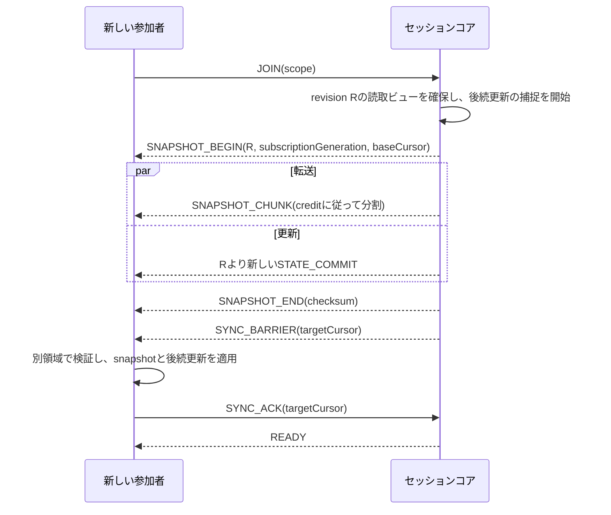

# 通信仕様: 初期同期・配送・流量制御をTransportから独立させる

状態: v0草案 / 2026-10-21。型名、数値ID、上限値は実装前の提案。
実行できるプロトタイプの仕様は[prototype.md](../protocol/prototype.md)、設計との差と確認結果は[実装状況](implementation-status.md)を参照。
上位の目的と構成は[全体設計](design.md)、公開APIは[SDK設計](sdk.md)を参照。

本文のTransportはデータを運ぶ通信実装、adapterはその機能差を共通APIへ合わせる実装を指す。revisionは共有状態の版、cursorはある購読先へどこまで届けたかを表す番号である。

## 1. 接続は能力を合意してからセッションへ参加する

```text
disconnected → connecting → authenticating → negotiating
             → syncing → ready → reconnecting → syncing → ready
             → closing → closed
```

`ready`は、その購読範囲の初期状態が整い、通常の更新を適用できる状態である。物理接続の成功だけではreadyにしない。復旧不能なら`failed`へ遷移し、理由を返す。明示的なcloseは再接続を止める。

1. HTTPSで参加資格と候補endpointを取得する。アプリが認証情報を提供し、SDKは短命のticketを扱う。
2. adapterを接続し、ticketと接続固有のchallengeを結び付けて認証する。具体的なproof形式は認証ADRで固定する。
3. `HELLO/WELCOME`でプロトコル版、上限、利用可能な機能を合意する。
4. `JOIN`でsessionと購読範囲を指定し、`JOINED`でmembership、epoch、durability、権限を受け取る。
5. 初期同期または再開を行い、`READY`後に公開APIのjoinを完了する。

能力には`reliableOrdered`、`datagram`、`boundedLatest`、`bulk`、`liveFrames`、最大payload、対応codec、暗号化方式、統計の有無を含める。QUIC DATAGRAM等は接続時の合意を確認する。WebSocketのような信頼性ストリームでlatestを模擬する場合は`boundedLatest: false`とし、送信済みデータの待ちを解消できない制限を通知する。[QUIC DATAGRAM仕様](https://www.rfc-editor.org/rfc/rfc9221.html)

公開モードでは、認証済み暗号化が非対応または合意できないadapterを拒否する。暗号化なしの試験接続は明示したローカル開発設定に限り、能力に`insecureDevelopment`を出す。通信方式の自動選択で公開接続から試験接続へ縮退させない。暗号ADRではticketとの結合、鍵交換・更新、nonce、replay防止、再接続時の鍵分離を決める。

能力はまず隣接する接続ごとに合意し、その後、送信元から各宛先までの経路の能力を公開する。中継層は宛先の上限へblobとliveを再分割し、transfer/frame IDとoffsetを維持する。中継時の組立bufferにも上限を設ける。latestは分割せず、対象経路で収まるサイズまでとする。

配信開始時は対象全員への適合を既定とし、不適合な宛先がいれば開始を拒否する。アプリが`allowPartialRecipients`を選んだときだけ、その宛先を明示的に除外する。後から加わった不適合peerは当該購読を拒否され、既存配信を暗黙に縮小しない。対象の変更はpublisherへ通知する。

## 2. MessagePackの共通部分だけをwireへ出す

アプリの標準値`Value`は、null、bool、有限の数値、UTF-8文字列、bytes、配列、文字列キーのmapとする。循環参照、undefined、NaN、Infinity、任意のクラス型は拒否する。欠損フィールドとnullは区別する。

整数として扱うアプリ値はJavaScriptで正確な範囲に制限する。それを超える整数、日時、Vector3等はアプリが明示した共通の構造にする。例えば日時はUTCのepoch milliseconds、位置は`[x, y, z]`。64bit整数用の型や独自extensionは、全SDKのテストベクトルとともに後から追加する。

プロトコル自身のrevision・sequenceはMessagePackの`uint64`を使い、JSでは`bigint`、C#とGoでは`ulong` / `uint64`で受ける。浮動小数点へ変換しない。診断JSONへは10進文字列で出す。アプリのValueの制限と混同しない。

MessagePack実装の既定値だけでは互換性は保証されない。C#のTypelessやランタイム固有extensionをwireへ出さず、map、整数、bytesのmappingをfixtureで確認する。重複map keyは拒否し、Unicodeのキーは勝手に正規化しない。[MessagePack仕様](https://github.com/msgpack/msgpack/blob/master/spec.md)・[JS実装](https://github.com/msgpack/msgpack-javascript)・[C#実装](https://github.com/MessagePack-CSharp/MessagePack-CSharp)

### 外枠とpayloadを分ける

以下は診断用の表現である。実際には一つのMessagePack mapとして送る。`body`は一度encodeしたValueのbytes、または指定codecのraw bytesにする。gatewayは外枠を検査し、宛先向けの認証情報を作り直して中継する。アプリpayloadを不要にdecode/encodeし直さない。

```text
{
  v: uint32, kind: uint16,
  session: string, epoch: string, membership: string,
  channel: uint16, channelGeneration: uint32,
  seq: uint64,
  op: string?, revision: uint64?,
  codec: "value.msgpack.v0" | "raw.v0",
  body: bytes
}
```

`kind`はバージョン管理されたregistryで固定する。最低限、HELLO、WELCOME、JOIN、JOINED、STATE_OP、STATE_COMMIT、OP_RESULT、SNAPSHOT_BEGIN/CHUNK/END、SYNC_BARRIER、SYNC_ACK、READY、RESUME、LATEST、EVENT、BLOB_*、LIVE_*、CREDIT、RETIRE/RETIRE_ACK、PING/PONG、ERROR、LEAVEを持つ。

必須フィールドや必須機能を理解できなければ接続を拒否する。追加された任意フィールドは無視してよいが、未知の操作を成功扱いにしない。エラーはコード、対象op、retryable、必要ならretryAfterを持つ。

### Transportごとのフレーミング

| 経路 | 区切り |
| --- | --- |
| QUIC reliable stream / IPC stream | 4byte big-endian長 + MessagePack外枠。長さ上限を確認してから確保 |
| WebRTC reliable DataChannel / LiteNetLib reliable | 一つのtransport messageに一つの外枠。サイズ超過はアプリ層で分割 |
| QUIC DATAGRAM / WebRTC非再送チャネル / LiteNetLib unreliable | 一つのdatagram/messageに一つの外枠。受信順を前提にしない |

MessagePackは圧縮でも暗号でもない。圧縮はblobごとの明示オプションとし、映像の再圧縮は行わない。展開後サイズの上限も適用する。

## 3. stateの成功は確定記録と一致させる

一つの操作は一つのkeyへのset / delete / CASとする。複数keyの原子更新はv0に入れず、必要なら一つのValueへまとめる。keyごとのversionは、そのkeyを最後に変更したsession revisionとする。

delete後も、再開期間中は削除の版を保持する。同じkeyが削除後に作り直されても、過去の版を指定したCASは失敗する。未作成を条件にする操作と、削除前の版を条件にする操作を区別する。

`STATE_OP`は`opId`、対象key、操作、任意のexpectedVersion、Valueを持つ。サーバーは認証、書込権限、上限、expectedVersionを検査する。受理時にはrevisionを一つ進め、状態・削除情報・重複排除記録を同じトランザクションで保存し、`STATE_COMMIT`と`OP_RESULT`を発行する。

永続モードの成功は、その保存先の耐久性契約に従って記録が確定したことを意味する。memoryモードの成功はプロセスメモリまで。どちらも接続後の`session.info.durability`で確認できる。

SDKのset成功は、確定結果の受信と、購読対象keyについてその版以上のローカルcache適用が終わってから返す。OP_RESULTがSTATE_COMMITより先に来ても、この条件を待つ。購読対象外のkeyはcache反映を保証せず、戻り値で確定値と版を返す。watch callbackの処理完了までは待たない。

`opId`はSDKが生成し、同じmembershipの再送で変えない。サーバーは処理済みなら同じ結果を返す。同じIDで異なるpayloadが来たら拒否する。接続断で応答が不明ならSDKは`pending/unknown`を公開し、status照会または同ID再送で確定する。ネットワーク全体での無条件なexactly-onceをうたわない。

重複排除はmembershipの再開可能期間中保持する。最終ACKから30分を初期案とし、その間は保持期限を延長する。期限外の操作は`OutcomeUnknown`とし、新しいIDを付けて自動再送しない。サーバー再起動でも、この記録を状態と同じ整合性で復元する。

session epochは通常の永続データ復元では保持し、部屋の作り直しや履歴の互換性を失うリセットで変更する。再開期限はサーバーが明示し、再開期間を越えたmembershipからの書込は拒否する。

## 4. snapshotと後続更新の境界を一つにする

初期同期中も他の参加者は更新を続ける。snapshot作成時にデータを長時間ロックせず、確定した一つの版を読み取れる保存方式を使う。



購読範囲外の変更は送らないため、session revisionには欠番があってよい。これと区別し、購読世代ごとに配送対象更新へ連続した`subscriptionCursor`を付ける。欠落検知・再開はこのcursorで行う。権限や購読範囲が変わったら世代を更新し、必要な再snapshotと範囲外キャッシュの破棄を行う。

SDKはsnapshotのbyte列のchecksum、件数、サイズを検証する。byte列を再encodeして比較しない。受信中のstateは別領域に作り、揃ってから公開cacheへ切り替える。snapshotと後続更新の重なりはversionで除く。buffer上限を超えたら同期を中断し、新しいsnapshotへやり直す。未完成の状態をreadyとして公開しない。

サーバーはsnapshot終了時点の購読cursorをSYNC_BARRIERで固定する。SDKはsnapshotの検証と、そのtargetCursorまでの連続適用が完了してからACKする。bulk側のSNAPSHOT_ENDだけでは完了と判定しない。以後のcommitは同じ順序で処理し、更新が続く部屋でも完了目標を無限に先送りしない。

`latest`、events、liveはsnapshotへ含めない。latestはready後の新しい送信で追いつく。必要ならpublisherへ現在値の再送を依頼できる。liveはcodec設定と次のkeyframeから開始する。

## 5. 再接続では状態とライブデータを違う方法で戻す

`RESUME`にsession epoch、membershipの再開token、購読世代、最後のcursor、未確定opIdを渡す。有効な期間内であれば欠けたcommitと操作結果を返す。履歴不足やepoch変更なら`ResyncRequired`としてsnapshotへ戻る。

回復中は確定stateの古いcacheを`stale`と表示し、readyと区別する。state操作は既定で待ち行列へ積まず`NotReady`を返す。切断前に送った未確定操作だけは上記の照会対象にする。オフライン編集を有効化する場合はアプリの明示設定と別の競合仕様を必要とする。

latest / liveは復旧前のものを破棄し、新しいpublisher世代で再開する。eventsも切断中の新規発行は失敗させ、期限切れイベントを後から流さない。明示した指数backoffとjitterで再接続し、ユーザーのcloseで停止する。

## 6. channelごとに異なる配送規則を持つ

| channel | 規則 | 受信側の追いつき |
| --- | --- | --- |
| control | reliable、順序あり、小容量。認証・ACK・credit | 接続世代で管理 |
| state | reliable、購読内順序あり、再開可能 | snapshot + commit履歴 |
| latest | unreliable、送信者・key単位の単調sequence | 古い番号を破棄 |
| events | reliable送信、期限あり、接続世代内で重複排除 | 新規参加者へ履歴を渡さない |
| live | unreliable fragments、frame単位の期限と復元判定 | 設定 + keyframe |
| bulk | reliable chunks、creditとoffset | 途中再開、全体hash確認 |

eventsの`publish`成功は「サーバーが配送を受け付けた」までとする。すべての受信アプリの処理完了は保証しない。受信完了が必要なアプリは、明示的な応答イベントを定義する。異なるpublisher間やchannel間には全順序を設けない。

| adapter | reliable系 | latest / live | bulk |
| --- | --- | --- | --- |
| WebRTC | ordered reliable DataChannelを用途別に使用 | unordered / maxRetransmits=0。アプリのsequenceで新旧判定 | 小さな分割message、bufferedAmountで送出抑制 |
| LiteNetLib | ReliableOrderedを用途別channelへ | UnreliableまたはSequenced。アプリのsequenceも保持 | 小さな分割message。下位queueへ積み過ぎない |
| QUIC | control/state用streamを分離 | DATAGRAM拡張の合意が必要 | 転送単位のstream、同時数とcreditを制限 |

WebRTCの複数DataChannel、LiteNetLibの複数channel、QUICの複数streamを使っても、同じ回線の輻輳は共有する。QUIC DATAGRAMは下位層で再送・分割される前提にしない。[WebRTC仕様](https://www.w3.org/TR/webrtc/)・[LiteNetLibの配送方式](https://revenantx.github.io/LiteNetLib/api/LiteNetLib.DeliveryMethod.html)

## 7. 送信待ちの増大を検知し、下位層へ渡す前に調整する

送出器はpeer・経路・channelごとにbyte数と最古データの待ち時間を計測する。通常は重み付き公平制御を用い、controlには小さな予約枠を与える。control自体もrate limitし、悪意ある大量発行で他を永久に止めさせない。state/eventsにも進捗枠を確保する。

| 種別 | 予算超過時の処理 |
| --- | --- |
| state | 新しい操作を`Backpressure`で拒否。受理済みcommitを黙って捨てない |
| latest | 未送信の同じkeyを最新値に置換。過剰なkey作成は拒否 |
| events | 未受理なら拒否。受理後に期限切れならexpiryを記録 |
| live | 完了期限に間に合わないframeと依存frameを落とす |
| bulk / snapshot | creditを止め、producerの非同期writeを待機させる |

小さなchunkに分け、adapterの送信可能量までしか渡さない。native側のkernel / library queueと、ブラウザの`bufferedAmount`を観測する。観測できないqueueはunknownとし、投入量を保守的に制限する。チャネルを分けるだけでなく、codec処理・hash・disk I/Oも大きな一回の処理で制御loopを占有しないようにする。

adapterは`trySend`の受付/WouldBlock、受付済みbytes、送信可能通知、最大message/datagram、観測可能なqueue量を提供する。受付は配送完了と区別する。送出器はwrite creditとpacingの予算内で呼び、WouldBlock時には新しいbulkを渡さない。QUIC等の輻輳制御へ大量に先積みせず、LiteNetLib側でもRTT・loss・滞留時間を使ったpacingの方式を検証する。queueが見えないadapterは安全な投入上限を実測できるまで低遅延対応と公表しない。

受付前のbytesはSDK queue、受付後はadapter in-flightとして区別する。下位層がbufferを手放した通知でローカル保持予算を返すが、これは相手の受信ACKではない。解放通知が取れないadapterでは、アプリ層の受信ACKまで残額から差し引いて保守的に制限する。latest/liveも定期的な最終受信sequence通知を利用できる。状態不明の残額をタイマーだけで解放して次々投入しない。

unreliableの全送信が欠落しても回復できるよう、期限切れのsequence範囲を独立したcontrol枠でRETIREとして送る。受信者は以後その範囲を適用せず、組立bufferを捨ててRETIRE_ACKを返す。これで配送待ちの論理windowを回収する。下位層のbuffer解放とは区別し、ローカルqueueの解放を確認できなければデータ用接続を閉じて世代を更新してから再開する。control自体が切断していれば、再接続処理で旧世代を終了させる。

reliableの未受信量と、receiverがまだ処理できない量は別のwindowで制限する。bulkの受信ACKはchunkの受領、creditはsinkが追加で受け入れられる量、doneは全体検証の完了を表す。in-flight上限は帯域とRTTから必要量を測って調整し、固定の小さなwindowでスループットを不用意に制限しない。

別の低速peerが同席しても、全員のqueueを一つに束ねない。recipientごとにcreditとqueueを持ち、broadcastの転送量は宛先数を含めて計上する。受信が追いつかないstate購読者にはresyncを要求し、上限を超えて保持し続けない。

## 8. bulkは完全性、liveは鮮度を守る

### bulk / snapshot

`TRANSFER_OPEN`でtransferId、既知ならサイズと内容hash、codec、必要権限を合意する。受信側が追加で受け入れられるbytesをcreditとして返し、CHUNKにはoffsetと長さを持たせる。再開時には受信済み範囲を照合する。同じtransferIdでも内容が変われば再開しない。

sourceはメモリ全体ではなくAsyncIterable / Stream / Reader等から読み、進捗・キャンセル・エラーを返す。受信側もsinkへ逐次writeする。全体をRAMへ展開するAPIは、利用者がサイズ制限を指定した場合だけ使う。完了はhash一致とsink完了後に返す。

逐次生成されるsourceではhashを読みながら計算し、TRANSFER_ENDで最終サイズとSHA-256を送る。事前の全件読取を要求しない。offsetから再読込できるsourceは途中再開できる。非seekableなsourceは再読込callback、または容量を制限したdisk spoolを明示的に使う場合だけ再開可能とする。再現できないsourceは切断時に失敗を返す。

### live

`LIVE_OPEN`はstreamId、generation、codec、timebase、codec設定、許容遅延、最大frameサイズを持つ。frameにはframeId、PTS、keyframe、依存関係、分割情報を付ける。1frameを一つの大きなdatagramに押し込まない。

受信者は数と容量の上限付きで分割片を集める。期限までに揃わなければframe全体を破棄する。参照frameが欠けた場合は依存するframeを表示せず、rate limit付きでkeyframeを要求する。途中参加もcodec設定を取得してkeyframeを待つ。

時間判定はローカルのmonotonic clockで行う。別端末のmonotonic timestampを直接比較しない。各hopは残り許容時間から自分のqueue滞留を引き、伝搬遅延の推定と不確かさを保持する。受信側にも到着後の最大待ち時間を設定する。厳密な一方向遅延を時計同期なしで測れたとは表示しない。

配信元には推奨bitrate、frame破棄率、keyframe要求を返す。SDKがcodecを持たない場合、アプリはこの通知をencoderへ渡す。帯域不足を単にSDK内部のqueueへ隠さない。

## 9. 上限の初期案を明示し、合意した小さい側を採る

以下は安全な実装開始のための暫定値。性能保証ではなく、検証後に変更する。bytesは外枠・暗号化等のoverheadも含めて管理する。

| 対象 | 暫定上限 |
| --- | --- |
| controlの外枠全体 | 8 KiB |
| 一つのstate Value | 64 KiB。大きいデータはblob参照 |
| 一回のreliable chunk | 最大16 KiB、adapterが示すmessage上限以下 |
| latest / live fragment | adapterが合意したunfragmented payload以下。固定MTUを仮定しない |
| latestの未送信値 | 256 key / peer、各1 KiBを初期上限 |
| live frame | 2 MiB / frame、組立中は4 MiBかつ4frame / publisher以下 |
| snapshot後続更新buffer | 8 MiB / 購読。超過でresync |
| アプリ層送信queue | 8 MiB / peer。channel別に内訳を制限 |
| Valueの深さ | 32階層。要素数と展開後bytesにも別上限 |

部屋全体・プロセス全体にも予算を持ち、peer数を掛けると無制限になる設定を避ける。受信者の能力により小さい値を合意し、SDKは超過を送信前に返す。ライブframeが上限を超えれば縮小・再encodeを呼出側へ要求する。

## 10. Transport成功とアプリ成功を区別する

エラーの最低集合は、`Unauthenticated`、`Forbidden`、`NotReady`、`Conflict`、`UnsupportedCapability`、`PayloadTooLarge`、`Backpressure`、`DeadlineExceeded`、`ResyncRequired`、`OutcomeUnknown`、`Cancelled`、`TransportClosed`とする。

lossやtimeoutで無制限に再送しない。operation、transfer、frameごとに期限・再開規則を適用する。通信が改善した場合にlive品質を戻す際もhysteresisを使い、経路やbitrateの頻繁な往復変更を避ける。
